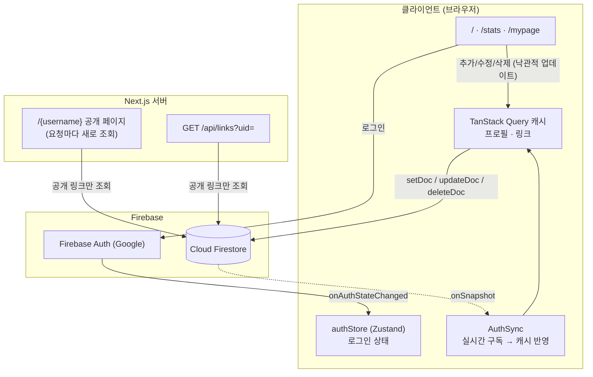

# 🔗 MyLink (마이링크)

> 흩어진 포트폴리오·블로그·SNS 링크를 **한 페이지에 모아 나만의 주소(`/username`)로 공유**하는 링크트리 서비스  
> Next.js 16 (App Router) · Firebase Auth · Cloud Firestore · TanStack Query · shadcn/ui (SOCAR Frame 2.0 디자인)

---

## ✨ 주요 기능

| 구분 | 기능 | 설명 |
| :--- | :--- | :--- |
| **로그인** | Google 로그인 | Firebase Authentication (팝업, 팝업 차단 시 리다이렉트 방식으로 자동 전환) |
| **프로필 자동 생성** | 첫 로그인 시 프로필 생성 | username = 이메일 앞부분(중복이면 `_2`, `_3` …), 표시 이름 = Google 이름 |
| **링크 관리** (`/`) | 추가 · 수정 · 삭제 · 공개 전환 | 낙관적 업데이트(화면 먼저 반영, 실패 시 자동 되돌림), 카테고리 필터, 대표 링크 지정 |
| **URL 검증** | 입력값 자동 보정 | 빈칸 방지, `https://` 자동 추가, http/https만 허용, 도메인·TLD 검사 |
| **공개 페이지** (`/{username}`) | 방문자용 링크 페이지 | 로그인 없이 누구나 열람, 공개 링크만 표시, 없는 사용자는 404 |
| **클릭 집계** | 링크 클릭 수 +1 | 방문자가 링크를 누르면 `increment(1)`로 원자적 증가 (보안 규칙으로 +1만 허용) |
| **통계** (`/stats`) | 클릭 통계 대시보드 | 총 클릭 수, 링크별 막대 차트, 카테고리별 도넛 차트, 클릭 순위 (실시간 갱신) |
| **프로필** (`/mypage`) | 프로필 · 계정 관리 | username(중복 확인) / 표시 이름 / 소개글 수정, 가입일·최근 로그인, 로그아웃 |
| **실시간 동기화** | Firestore `onSnapshot` | 다른 탭·기기에서 바꾼 내용과 방문자 클릭 수가 바로 반영 |

---

## 🏗️ 아키텍처 및 데이터 흐름



### Firestore 데이터 구조

```text
users/{uid}                      # 계정 정보 (email, photoURL, createdAt, lastLoginAt) - 본인만
users/{uid}/profile/main         # 공개 프로필 (username, displayName, bio) - 누구나 읽기
users/{uid}/links/{linkId}       # 링크 (title, url, category, isActive, isFeatured, order, clickCount ...)
usernames/{username}             # username → uid 인덱스 (중복 방지, 공개 페이지 조회용)
```

보안 규칙은 [`firestore.rules`](firestore.rules)에 있습니다.

- 링크: 공개 링크는 누구나 읽기, 비공개는 본인만 / 생성·삭제·수정은 본인만 / 방문자는 `clickCount` **+1만** 가능
- username: 3~20자 `a-z0-9_`, 예약어(`mypage`, `api`, `stats` 등) 금지, 수정 불가(변경 시 새로 만들고 이전 것 삭제)

---

## 🛠️ 기술 스택

| 분류 | 사용 기술 |
| :--- | :--- |
| Framework | Next.js 16 (App Router, Turbopack), React 19, TypeScript 5 |
| 인증 / DB | Firebase 13 — Authentication(Google), Cloud Firestore |
| 서버 상태 | TanStack Query 5 (낙관적 업데이트 + Firestore 실시간 구독) |
| 클라이언트 상태 | Zustand 5 (로그인 상태) |
| UI | Tailwind CSS v4, shadcn/ui (Radix UI), lucide-react, sonner(토스트), Recharts(차트) |
| 디자인 | SOCAR Frame 2.0 디자인 토큰 ([docs/design.md](docs/design.md)) |

---

## 📂 디렉토리 구조

```text
src/
├── app/
│   ├── page.tsx                  # 메인: 로그아웃 → 소개(Landing) / 로그인 → 링크 관리(LinkDashboard)
│   ├── stats/page.tsx            # 클릭 통계 (로그인 전용)
│   ├── mypage/page.tsx           # 프로필 · 계정 관리 (로그인 전용)
│   ├── [username]/
│   │   ├── page.tsx              # 공개 링크 페이지 (서버 컴포넌트)
│   │   └── not-found.tsx         # 사용자 없음 404
│   ├── api/links/route.ts        # GET: 특정 사용자의 공개 링크 조회 API
│   ├── layout.tsx                # QueryProvider · AuthSync · Toaster
│   └── globals.css               # Tailwind v4 + 디자인 토큰
├── components/
│   ├── AuthSync.tsx              # 로그인 감지 + 프로필/링크 실시간 구독 → Query 캐시
│   ├── AppHeader.tsx             # 공통 헤더 (링크 | 통계 | 프로필 탭)
│   ├── AuthButton.tsx            # Google 로그인 버튼 / 프로필 메뉴
│   ├── ProfileMenu.tsx           # 프로필 드롭다운 (공개 페이지 열기·복사, 로그아웃)
│   ├── Landing.tsx               # 로그아웃 상태 소개 화면
│   ├── LinkDashboard.tsx         # 링크 관리 화면
│   ├── MyPageCard.tsx            # 내 페이지 요약 (공유 주소, 통계)
│   ├── LinkRow.tsx               # 링크 목록 한 줄 (공개 스위치, 수정, 삭제)
│   ├── LinkModal.tsx             # 링크 추가/수정 모달 (URL 검증)
│   ├── DeleteConfirmDialog.tsx   # 삭제 확인
│   ├── CategoryFilter.tsx        # 카테고리 필터 칩
│   ├── StatsDashboard.tsx        # 통계 차트
│   ├── ProfileEditCard.tsx       # 프로필 수정 (username 중복 확인)
│   ├── AccountCard.tsx           # 계정 정보 · 로그아웃
│   ├── TrackedLink.tsx           # 공개 페이지 링크 (클릭 수 집계)
│   ├── icons.tsx                 # 카테고리/소셜 아이콘
│   └── ui/                       # shadcn/ui 컴포넌트
├── lib/
│   ├── firebase.ts               # Firebase 초기화
│   ├── authStore.ts              # 로그인 상태 (Zustand), users/{uid} 저장
│   ├── queries.ts                # TanStack Query 훅 (조회 + 낙관적 mutation)
│   ├── firestoreLinks.ts         # 링크 CRUD · 공개 링크 조회 · 클릭 증가 · 실시간 구독
│   ├── profile.ts                # 프로필 생성/저장, username 검증·중복 처리
│   ├── publicProfile.ts          # 공개 페이지 데이터 조회
│   ├── categories.ts             # 카테고리 정의 (포트폴리오 / 공용 웹사이트 / 기타)
│   ├── url.ts                    # URL 정규화 · 검증
│   └── publicUrl.ts              # 공개 페이지 주소 생성
└── types/link.ts                 # LinkItem 등 타입
```

---

## 🚀 로컬 실행 방법

### 1. 패키지 설치

```bash
npm install
```

### 2. Firebase 설정

1. [Firebase 콘솔](https://console.firebase.google.com)에서 프로젝트 생성 → 웹 앱 등록
2. **Authentication → 로그인 방법 → Google** 사용 설정
3. **Authentication → 설정 → 승인된 도메인**에 배포 도메인 추가 (`localhost`는 기본 포함)
4. **Firestore Database** 생성 후, [`firestore.rules`](firestore.rules) 내용을 **규칙** 탭에 붙여넣고 게시  
   (또는 `firebase deploy --only firestore:rules`)

### 3. 환경 변수 (`.env.local`)

```env
NEXT_PUBLIC_FIREBASE_API_KEY="your_api_key"
NEXT_PUBLIC_FIREBASE_AUTH_DOMAIN="your-project.firebaseapp.com"
NEXT_PUBLIC_FIREBASE_PROJECT_ID="your-project"
NEXT_PUBLIC_FIREBASE_STORAGE_BUCKET="your-project.firebasestorage.app"
NEXT_PUBLIC_FIREBASE_MESSAGING_SENDER_ID="your_sender_id"
NEXT_PUBLIC_FIREBASE_APP_ID="your_app_id"
NEXT_PUBLIC_FIREBASE_MEASUREMENT_ID="your_measurement_id"
```

> `.env*` 파일은 `.gitignore`에 포함되어 커밋되지 않습니다.

### 4. 개발 서버 실행

```bash
npm run dev
```

[http://localhost:3000](http://localhost:3000) 접속 → Google 로그인 → 링크 추가 → 상단 카드의 **열기**로 내 공개 페이지(`/username`) 확인

### 기타 명령어

```bash
npm run build      # 프로덕션 빌드
npm run start      # 빌드 결과 실행
npx tsc --noEmit   # 타입 검사
npx eslint src     # 린트
```

---

## 🔌 API

### `GET /api/links?uid={uid}&category={category}`

특정 사용자의 **공개 링크**를 대표 링크 → 순서(order) 순으로 반환합니다. (서버에는 로그인 정보가 없어 비공개 링크는 포함되지 않습니다.)

| 파라미터 | 필수 | 설명 |
| :--- | :---: | :--- |
| `uid` | ✅ | 조회할 사용자 uid |
| `category` | | `PORTFOLIO` \| `WEBSITE` \| `ETC` \| `ALL` |

```json
{
  "status": "success",
  "statusCode": 200,
  "data": { "links": [ /* LinkItem[] */ ], "total": 3 },
  "timestamp": "2026-11-22T00:00:00.000Z"
}
```

`POST /api/links`는 본인 확인이 불가능해 **405**를 반환합니다. 링크 추가는 로그인 후 화면에서만 가능합니다.

---

## 🐞 최근 버그 수정 (2026-11-22)

| 문제 | 원인 | 해결 |
| :--- | :--- | :--- |
| 공개 페이지에 링크 변경이 반영되지 않을 수 있음 (배포 환경) | 첫 요청 결과가 정적 캐시로 굳을 수 있었음 | `connection()`으로 요청마다 새로 조회 |
| `/%E0` 같은 잘못된 주소에서 500 에러 | `decodeURIComponent`가 예외를 던짐 | 디코딩 실패 시 404 처리 |
| `GET /api/links`가 항상 빈 목록 반환 | 비로그인 요청이 공개 조건 없이 전체 조회 → 보안 규칙에 막힘 → 에러를 숨기고 `[]` 반환 | 공개 링크만 조회, 실패 시 500 응답, 목데이터 병합 제거 |
| 이메일 앞부분이 짧은 사용자의 기본 username이 계속 바뀜 | `Math.random()` 접미사 | uid 기반 고정 접미사 |
| 프로필 자동 생성이 권한 오류로 실패할 수 있음 | 이미 내 것인 `usernames` 문서를 다시 쓰기(update 금지) | 문서가 없을 때만 생성 |

---

## 🗺️ 앞으로 할 일

- 링크 순서 드래그 앤 드롭 재정렬
- 공개 페이지 프로필 사진 · 테마 커스터마이징
- 날짜별 클릭 추이 통계
- 사용하지 않는 NextAuth 설정(`src/auth.ts`, `/api/auth`) 정리 — 현재 로그인은 Firebase Auth로 동작
