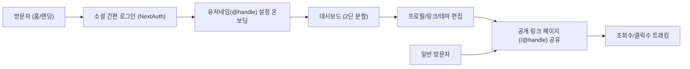
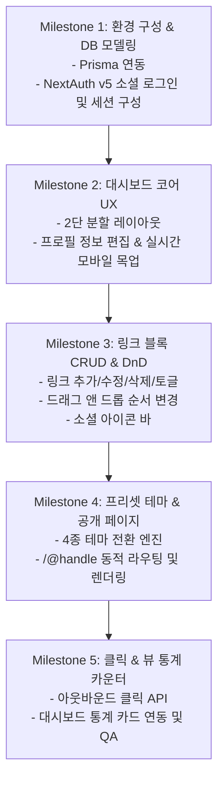

# [PRD] 멀티테넌트 링크트리 클론 서비스 — "마이링크 (MyLink)" 기능 정의서

- **버전**: v1.0.0 (MVP)
- **작성일**: 2026-10-17
- **상태**: 승인 및 개발 착수 준비
- **디자인 기반**: SOCAR Frame 2.0 Design System

---

## 1. 프로젝트 개요 (Overview)

### 1.1 배경 및 목적
인플루언서, 개발자, 크리에이터 및 일반 사용자가 흩어져 있는 자신의 SNS, 포트폴리오, 프로젝트, 블로그 등의 링크를 단 하나의 고유 URL(`/@username`)에 깔끔하게 모아 브랜딩할 수 있는 **멀티테넌트 링크트리 클론 서비스**를 구축합니다.

### 1.2 핵심 가치
- **본질에 집중한 절제된 UX**: 불필요한 장식을 덜어내고 콘텐츠와 가독성에 집중 (SOCAR Frame 2.0 시각 언어 기반)
- **실시간 반응형 대시보드**: 링크 수정 시 즉시 모바일 목업에 반영되는 직관적인 라이브 프리뷰
- **신뢰할 수 있는 성능 & 확장성**: Next.js 16 App Router와 PostgreSQL + Prisma 기반의 안정적인 아키텍처

---

## 2. 사용자 페르소나 및 핵심 유즈케이스

### 2.1 대상 사용자
1. **크리에이터 / 인플루언서**: 인스타그램, 유튜브, 오픈채팅방, 협찬 링크 등을 단일 링크로 전달하고자 하는 사용자
2. **개발자 / 디자이너**: GitHub, 포트폴리오, 블로그, 이력서 링크를 정갈하고 신뢰감 있게 공유하고자 하는 구직자 및 실무자
3. **일반 방문자**: 공유된 `/@username` 링크를 통해 모바일/웹에서 빠르고 쾌적하게 원하는 링크로 이동하려는 방문자

### 2.2 핵심 유저 플로우


---

## 3. 기능 요구사항 명세 (Functional Requirements)

### 3.1 사용자 인증 및 계정 관리 (Authentication & Onboarding)
| ID | 기능명 | 상세 설명 | 우선순위 |
|---|---|---|---|
| **AUTH-01** | 소셜 로그인 | Google, GitHub 등 OAuth 기반 소셜 간편 로그인 제공 (NextAuth v5) | P0 (Must) |
| **AUTH-02** | 고유 핸들 온보딩 | 첫 로그인 시 영문/숫자/하이픈 기반의 고유 유저네임(`@handle`) 설정 및 중복 확인 | P0 (Must) |
| **AUTH-03** | 세션 & 보안 | JWT 세션 유지 및 비인가 사용자의 타인 대시보드 접근 차단 (Middleware 보호) | P0 (Must) |
| **AUTH-04** | 로그아웃 / 탈퇴 | 대시보드 내 로그아웃 및 계정 삭제 기능 | P1 (Should) |

### 3.2 링크 & 블록 관리 (Link Management)
| ID | 기능명 | 상세 설명 | 우선순위 |
|---|---|---|---|
| **LINK-01** | 웹 링크 블록 추가 | 링크 제목(Title), 연결 URL을 입력하여 새 링크 블록 생성 | P0 (Must) |
| **LINK-02** | 링크 ON/OFF 토글 | 삭제하지 않고도 특정 링크의 공개 페이지 노출 여부를 스위치로 즉시 전환 | P0 (Must) |
| **LINK-03** | 드래그 앤 드롭 순서 변경 | 핸들러 아이콘을 드래그하여 링크들의 노출 순서(Display Order)를 직관적으로 변경 | P0 (Must) |
| **LINK-04** | 소셜 아이콘 링크 바 | Instagram, YouTube, GitHub, X, Mail 등의 프로필 URL을 등록하여 페이지 상/하단에 아이콘 바 형태로 노출 | P0 (Must) |
| **LINK-05** | 링크 수정 및 삭제 | 기등록된 링크 제목/URL 인라인 수정 및 삭제 확인 다이얼로그(Alert) | P0 (Must) |

### 3.3 대시보드 편집기 UI (Dashboard Editor UX)
| ID | 기능명 | 상세 설명 | 우선순위 |
|---|---|---|---|
| **DASH-01** | 2단 분할 레이아웃 | 데스크톱 기준 좌측: 프로필/링크/테마 제어판, 우측: 스마트폰 목업 라이브 프리뷰 | P0 (Must) |
| **DASH-02** | 실시간 라이브 프리뷰 | 좌측에서 링크 텍스트 수정, 순서 변경, 테마 변경 시 우측 폰 목업에 즉시 렌더링 | P0 (Must) |
| **DASH-03** | 프로필 기본 정보 편집 | 프로필 사진(URL 또는 업로드), 표시 이름(Display Name), 한 줄 소개(Bio) 편집 | P0 (Must) |
| **DASH-04** | 내 페이지 URL 복사 | 상단 앱바에서 내 고유 링크(`mylink.com/@handle`)를 원클릭 복사하는 액션 버튼 | P0 (Must) |

### 3.4 테마 & 스타일링 (Theme & Customization)
| ID | 기능명 | 상세 설명 | 우선순위 |
|---|---|---|---|
| **THM-01** | 4대 프리셋 테마 | SOCAR Frame 2.0 기반으로 설계된 정갈한 4가지 프리셋 테마 중 선택<br>1. **Modern Blue**: 쏘카 블루 액센트 + 플랫 화이트 카드<br>2. **Clean White**: 미니멀 1px 그레이 보더 + 퓨어 화이트<br>3. **Charcoal Dark**: 차분하고 깊이 있는 다크 테마<br>4. **Soft Gray**: 은은한 블루 틴트 그레이 워시 테마 | P0 (Must) |
| **THM-02** | 인터랙션 피백 | 버튼 탭 시 96% 스케일 다운(`socar-press`) 및 매끄러운 트랜지션 | P0 (Must) |
| **THM-03** | 이모지 배제 원칙 | 이모지 대신 정식 SVG 라인/필 아이콘 적용으로 세련된 신뢰감 유지 | P0 (Must) |

### 3.5 공개 프로필 페이지 (Public Profile Page)
| ID | 기능명 | 상세 설명 | 우선순위 |
|---|---|---|---|
| **PUB-01** | 고유 URL 라우팅 | `/[handle]` 또는 `/@handle` 경로를 통해 해당 사용자의 공개 프로필 페이지 렌더링 | P0 (Must) |
| **PUB-02** | 반응형 모바일 최적화 | 320px 모바일 스몰부터 태블릿/데스크톱까지 완벽한 1단 카드 레이아웃 유지 | P0 (Must) |
| **PUB-03** | 링크 아웃바운드 클릭 | 링크 클릭 시 새 탭으로 타깃 URL 이동 및 클릭 이벤트 로깅 | P0 (Must) |
| **PUB-04** | SEO & 메타태그 | 사용자 프로필 기반의 동적 Open Graph(OG) 태그 및 파비콘 제공 | P1 (Should) |

### 3.6 애널리틱스 & 통계 (Analytics & Tracking)
| ID | 기능명 | 상세 설명 | 우선순위 |
|---|---|---|---|
| **STAT-01** | 페이지 총 뷰 수 | 공개 프로필 페이지 방문 시 총 조회수(Views) 카운팅 | P0 (Must) |
| **STAT-02** | 링크별 클릭 수 | 각 링크 블록 클릭 시 해당 링크의 총 클릭 수(Clicks) 카운팅 | P0 (Must) |
| **STAT-03** | 대시보드 통계 배지 | 대시보드 상단 및 각 링크 카드에 총 뷰/클릭 수 실시간 뱃지 노출 | P0 (Must) |

---

## 4. 데이터베이스 스키마 설계 (Prisma / PostgreSQL)

```prisma
datasource db {
  provider = "postgresql"
  url      = env("DATABASE_URL")
}

generator client {
  provider = "prisma-client-js"
}

// 1. 사용자 계정
model User {
  id            String    @id @default(cuid())
  name          String?
  email         String?   @unique
  emailVerified DateTime?
  image         String?
  createdAt     DateTime  @default(now())
  updatedAt     DateTime  @updatedAt

  accounts      Account[]
  sessions      Session[]
  profile       Profile?
}

// 2. NextAuth OAuth 계정
model Account {
  id                String  @id @default(cuid())
  userId            String
  type              String
  provider          String
  providerAccountId String
  refresh_token     String? @db.Text
  access_token      String? @db.Text
  expires_at        Int?
  token_type        String?
  scope             String?
  id_token          String? @db.Text
  session_state     String?

  user User @relation(fields: [userId], references: [id], onDelete: Cascade)

  @@unique([provider, providerAccountId])
}

model Session {
  id           String   @id @default(cuid())
  sessionToken String   @unique
  userId       String
  expires      DateTime
  user         User     @relation(fields: [userId], references: [id], onDelete: Cascade)
}

// 3. 사용자 프로필 & 페이지 설정
model Profile {
  id          String   @id @default(cuid())
  userId      String   @unique
  handle      String   @unique // 예: "limgyumin" -> /@limgyumin
  displayName String
  bio         String?
  avatarUrl   String?
  theme       String   @default("modern-blue") // modern-blue, clean-white, charcoal-dark, soft-gray
  viewsCount  Int      @default(0)
  createdAt   DateTime @default(now())
  updatedAt   DateTime @updatedAt

  user        User     @relation(fields: [userId], references: [id], onDelete: Cascade)
  links       Link[]
  socials     SocialLink[]
}

// 4. 링크 블록
model Link {
  id          String   @id @default(cuid())
  profileId   String
  title       String
  url         String
  isActive    Boolean  @default(true)
  order       Int      @default(0)
  clicksCount Int      @default(0)
  createdAt   DateTime @default(now())
  updatedAt   DateTime @updatedAt

  profile     Profile  @relation(fields: [profileId], references: [id], onDelete: Cascade)

  @@index([profileId, order])
}

// 5. 소셜 아이콘 링크
model SocialLink {
  id        String   @id @default(cuid())
  profileId String
  platform  String   // instagram, youtube, github, x, linkedin, email
  url       String
  order     Int      @default(0)
  createdAt DateTime @default(now())

  profile   Profile  @relation(fields: [profileId], references: [id], onDelete: Cascade)
}
```

---

## 5. 기술 스택 & 시스템 아키텍처

- **프론트엔드 / 백엔드**: Next.js 16 (App Router), React 19, TypeScript
- **스타일링**: Tailwind CSS v4, SOCAR Frame 2.0 Color Tokens & Utilities
- **폰트**: Pretendard Variable (jsDelivr CDN)
- **인터랙션 / 드래그앤드롭**: `@hello-pangea/dnd` 또는 `@dnd-kit/core`
- **인증**: NextAuth.js v5 (Auth.js) OAuth Providers
- **데이터베이스 & ORM**: PostgreSQL (Supabase / Neon) + Prisma ORM
- **배포 인프라**: Vercel (Next.js 호스팅) + Supabase (Database)

---

## 6. 개발 마일스톤 및 로드맵



---

## 7. 비기능적 요구사항 (Non-Functional Requirements)

1. **응답 성능**: 공개 프로필 페이지는 Server-Side Rendering(SSR) 또는 Incremental Static Regeneration(ISR)을 활용하여 첫 로딩 속도 LCP < 1.0s 달성
2. **모바일 사용성**: 모든 탭 타깃은 44px 이상 확보, 한 손 조작이 편한 하단/중앙 위주 인터페이스 배치
3. **디자인 무결성**: SOCAR Frame 2.0 원칙에 따라 이모지 사용을 엄격히 배제하고 통일된 SVG 아이콘 사용
